  

 

Breaking something is the fastest way I know to understand it. I go after
offensive security, the maths behind cryptography and blockchain, and the weak
spots of LLM apps, then turn what I learn into small tools.

  

 

