  

 

> **i don't trust anything i haven't broken first.**

login forms make me suspicious.
protocols make me curious.
a clever piece of math makes me want to find the bug in it.

  

 

things living in my head right now:

- why does this work, and why does it die when i change one byte
- the exact moment a "harmless" misconfig turns into full access
- crypto that's perfect on paper and broken in the code
- smart contracts guarding real money with one missing check
- chatbots that obey whoever spoke last
- tools i wish existed, so i build them

lab VPNs kept dying on my WSL2, so i wrote [ovpnx](https://github.com/r0guekimo/ovpnx). it's still the best thing i've shipped.

what i'm not: a tutorial collector, a certificate collector, or someone who runs a tool without knowing what it sends.

 

authorized targets only. i like my accounts unbanned.

